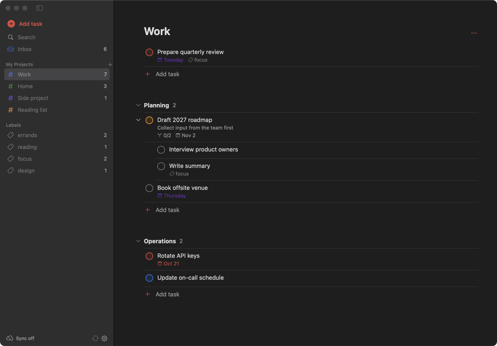

# TodoTim

A fast, calm, native macOS to-do app, driven from the keyboard with vim motions and dressed in
[Catppuccin](https://catppuccin.com). Your tasks stay on your own CalDAV server, as standard task lists that other
task apps can share.



TodoTim was inspired by [Todoist](https://todoist.com) and keeps what matters for working through a list:
projects, sections, tasks and sub-tasks, labels, and Quick Add in plain language. It leaves out Today, Upcoming,
the calendar and board views.

## Features

- Vim motions: `j` `k` to move through tasks, `gg` `G` to jump to the top or bottom of a section, `h` `l` to hide
  and show sub-tasks, `/` to search and `Esc` to step back out. Todoist's single-key shortcuts do the rest
  (press `?` in the app for all of them)
- Catppuccin colours: Mocha in Dark Mode, Latte in Light Mode
- Projects with colours, sections, tasks and nested sub-tasks
- Priorities (p1–p4), due dates, labels and descriptions
- Import from Todoist (File › Import from Todoist…, with your API token)
- Quick Add with natural language: `Renew passport next friday p1 @errands #Home /Admin`
- Search, label views, completed-task view, and undo for complete and delete
- Local-first: works offline, and syncs over CalDAV in the background
- Native SwiftUI app with no third-party dependencies

## Install

1. Download `TodoTim-vX.Y.Z.zip` from the [latest release](https://github.com/timvink/todotim/releases/latest).
2. Verify that GitHub Actions built the zip from this repository (needs the [GitHub CLI](https://cli.github.com)):

       gh attestation verify TodoTim-vX.Y.Z.zip --repo timvink/todotim

   The `.sha256` file on the release only detects a damaged download (`shasum -a 256 -c TodoTim-vX.Y.Z.zip.sha256`);
   it comes from the same place as the zip, so it does not prove who built it.
3. Unzip it and move `TodoTim.app` to `/Applications`.
4. Open the app. macOS blocks it the first time. Go to **System Settings › Privacy & Security**, scroll to
   the message about TodoTim, click **Open Anyway**, and confirm.

TodoTim is ad-hoc signed with the hardened runtime, but not signed with an Apple Developer ID and not
notarized. macOS therefore cannot tell you who published it, and Apple has not scanned it. The attestation
check in step 2 is what ties the download to this repository. Don't remove the quarantine attribute with
`xattr`; use **Open Anyway** for this one app instead. (Developer ID signing plus notarization would remove this
step, but needs a paid Apple Developer account.)

Requires macOS 15 (Sequoia) or later, on Apple silicon or Intel.

## Sync with CalDAV

TodoTim syncs with any CalDAV server that stores to-dos (VTODO). Each project is a task list (a calendar that
holds only to-dos), and the inbox is the list "Inbox". Other CalDAV task apps, such as the Nextcloud Tasks app,
Thunderbird or DAVx⁵-based clients on Android, see and edit the same tasks. Sections, labels, subtasks and
manual order sync too, and TodoTim keeps what other apps add, such as reminders. Calendars with events are left
alone. [docs/caldav.md](docs/caldav.md) describes the mapping.

TodoTim is developed against Nextcloud, and its sync test also passes against [Radicale](https://radicale.org)
and [Xandikos](https://www.xandikos.org). Other standard servers, such as Baïkal, should work too. iCloud does
not: it keeps your calendars on another server than the one you sign in to, and TodoTim sends your password
only to the server you enter.

For example, with Nextcloud:

1. In Nextcloud, go to **Settings › Security › Devices & sessions** and create an app password.
2. In TodoTim, open **Settings** (`⌘,`) and fill in:
   - **Server URL**: `https://your.cloud/remote.php/dav/`
   - **Username** and the **app password**
3. Click **Test connection**, turn on sync, and close the window.

For another server, enter its CalDAV address and your username and password, for example
`https://dav.example.com/` for Radicale or `https://dav.example.com/dav.php/` for Baïkal. TodoTim finds your
calendars from that address (it asks the server for your calendar home, as RFC 6764 describes), so the plain
`https://` address of the server often works too. If it finds none, it uses `calendars/USERNAME/` below the
server URL, the Nextcloud layout.

The first sync uploads your existing projects and tasks. Running it again creates no duplicates.

TodoTim syncs a few seconds after each change, every minute, and when you press `⌘R`. An idle sync is a single
request. The sidebar shows "Synced" with a green cloud when the server has every change, and "Sync pending" while
a change waits to be sent. Your password is stored in the macOS Keychain, per server: after you change the server URL, enter the
password again. Local data lives in `~/Library/Application Support/TodoTim/` (`db.json`, plus
`caldav-state.json`, which records where your calendars are and what the last sync saw).

When two devices edit the same task, the most recent edit wins. When TodoTim and another app change the same
project, section or label, TodoTim's change wins.

Completing a repeating task (one with a repeat rule from another app) moves it to its next due date, as other
task apps do. Daily, weekly, monthly and yearly repeats with an interval, count or end date are supported;
TodoTim completes tasks with other repeat rules normally.

### Configure with a dotfile

Instead of the Settings window, you can configure sync in `~/.todotim.toml` (or the path in `TODOTIM_CONFIG`),
which suits dotfile managers such as chezmoi. While the file has a `[sync]` table, the app uses it and shows
those settings read-only.

```toml
# TodoTim — https://github.com/timvink/todotim
repository = "https://github.com/timvink/todotim"

[sync]
enabled = true
server_url = "https://your.cloud/remote.php/dav/"
username = "USERNAME"
# Optional. Prints the password; runs once per launch, and TodoTim keeps it in memory instead of the Keychain.
password_command = "rbw get 'Nextcloud app password'"
# Optional, Nextcloud only. Users each new list is shared with (read-write), e.g. an assistant's account.
share_with = ["tasks-agent"]
```

`password_command` runs in your login shell, so tools from Homebrew are found. Leave it out to enter the
password in Settings instead. TodoTim versions before CalDAV sync used `folder` and a
`.../remote.php/dav/files/USERNAME/` URL. TodoTim ignores `folder` now, and accepts that URL as the DAV root.

## Security

- **Credentials.** The app password is stored in the macOS Keychain (service `TodoTim WebDAV`, a name kept from
  earlier versions), under an account named after both user and server, for example `tim@cloud.example.com`.
  With `password_command`, the password is kept in memory only and the Keychain is not read. A password saved for one server is never sent to another. TodoTim never logs it or shows `password_command` output.
- **HTTPS only.** TodoTim refuses `http://` server URLs (except `localhost`). It sends requests only to the
  server URL's host: while finding your calendar home it follows redirects on that host only, and after that it
  stays inside the server URL (or the calendar home, when that lies outside it). A principal, home or redirect on
  another host, or from https to http, is refused.
- **Config file trust.** `~/.todotim.toml` (and `TODOTIM_CONFIG`) can run a command and decides where the
  password is sent, so TodoTim only reads it when the file (after following symlinks) is a regular file owned by
  you and not writable by group or others, in a folder others can't write to. `chmod 600 ~/.todotim.toml` is
  a good default.
- **Remote data.** Data from the server is validated: ids must be short `[A-Za-z0-9_-]` strings (others are
  mapped to derived ids), calendar data is parsed with size, line and nesting limits, and responses, text
  lengths and subtask depth are limited.
- **Local data** in `~/Library/Application Support/TodoTim/` is readable only by you.

Report vulnerabilities privately as described in [SECURITY.md](SECURITY.md).

## Keyboard shortcuts

TodoTim moves like vim:

| Key | Action |
|---|---|
| `j` / `k`, `↓` / `↑` | Next / previous task. With nothing selected, the top / bottom of the current section |
| `gg` / `G` | First / last task of the section |
| `h` / `l` | Hide / show sub-tasks. On a sub-task, `h` hides its list and selects the parent |
| `/` | Search. `Esc` leaves the search field, and a second `Esc` returns to the list you came from |
| `g` then `i` | Go to Inbox |
| `Esc` | Close the editor or popover, then clear the selection |

The other shortcuts follow Todoist and macOS:

| Key | Action |
|---|---|
| `q`, `⌘N` | Quick Add |
| `a` / `⇧A` | Add task at the bottom / top of the current section |
| `s` | Add section |
| `Enter` | Open selected task |
| `e`, `⌘↩` | Complete or reopen task |
| `1`–`4` | Set priority |
| `t` / `@` / `v` | Set date / labels / move to project |
| `⌘]` / `⌘[` | Indent / outdent (make subtask) |
| `⌘↑` / `⌘↓` | Move task up / down |
| `⌘⌫` | Delete task |
| `⌘Z` | Undo complete or delete |
| `⌘F` | Search |
| `⌘1` | Go to Inbox |
| `⌘2`…`⌘9` | Go to project 1–8 |
| `⇧⌘C` | Show or hide completed tasks |
| `⌘R` | Sync now |
| `?` | Show all shortcuts |

## Quick Add syntax

| Token | Meaning |
|---|---|
| `p1` … `p4` | Priority |
| `@label` | Label (created if new) |
| `#Project` | Project (multi-word names work) |
| `/Section` | Section in that project |
| `today`, `tomorrow`, `friday`, `next week`, `in 3 days`, `jan 5`, `2026-11-03`, `no date` | Due date |

## Build from source

    swift build
    swift test
    scripts/bundle.sh && open build/TodoTim.app

See [CONTRIBUTING.md](CONTRIBUTING.md) for development and the release process, and [AGENTS.md](AGENTS.md) for the
architecture.

## License

[MIT](LICENSE)
